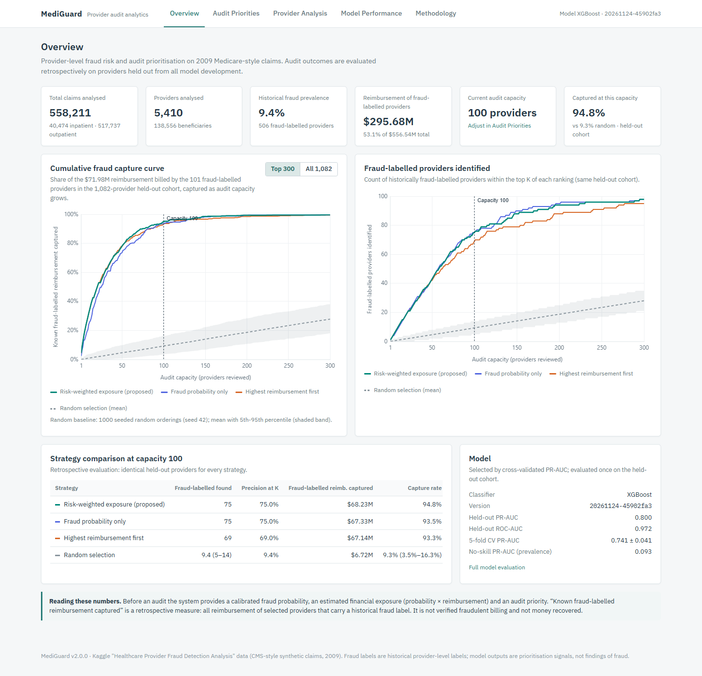
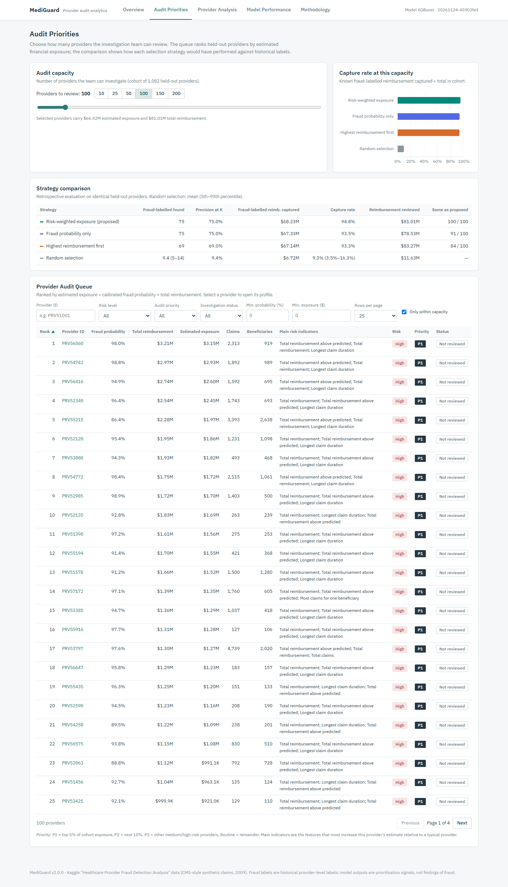
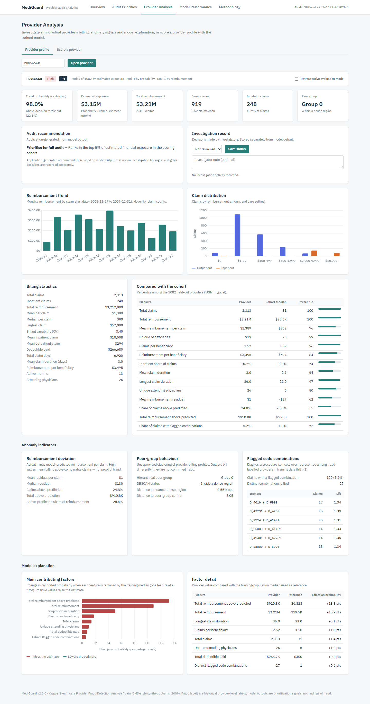
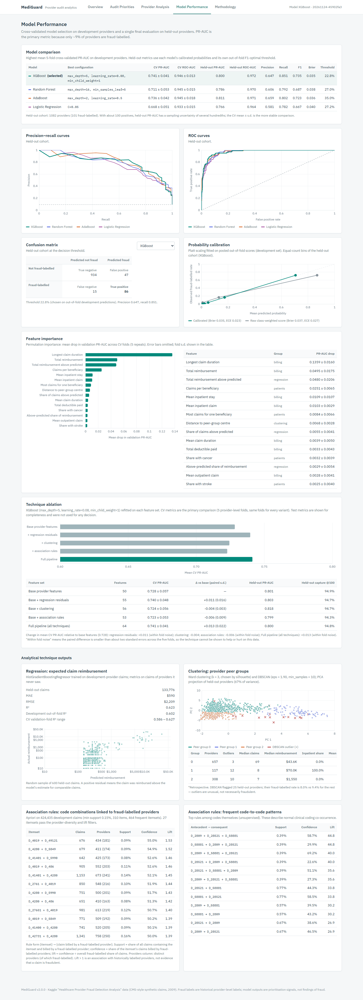
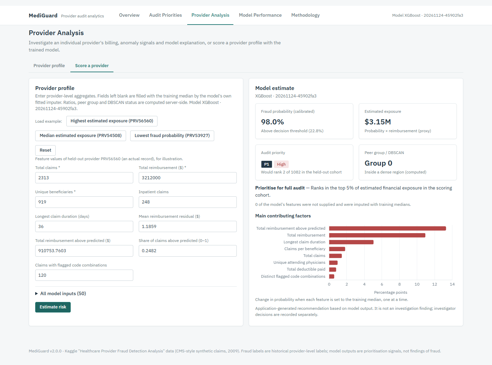

# MediGuard — Healthcare Provider Fraud Analytics & Audit Prioritization

MediGuard scores Medicare-style healthcare providers for fraud risk and turns those scores into an
**audit queue for an investigation team with limited capacity**. It is an end-to-end system:
reproducible data pipeline, four analytical techniques that feed a provider-level classifier,
leakage-controlled evaluation, an audit-capacity simulator, a Flask inference API with persistent
investigation records, and a web workspace for investigators.



---

## 1. Problem

An insurer's investigation unit can audit only a small fraction of providers each cycle. Picking
providers by classification accuracy alone ignores money: a small clinic with a 99% fraud
probability that billed $2,000 matters less than a large provider with a 60% probability that
billed $2M. MediGuard therefore ranks providers by an **estimated financial exposure**:

```
estimated exposure_i = calibrated P(provider i is fraud-labelled) × total reimbursement_i
```

It then measures, on providers the model never saw, how much historically fraud-labelled
reimbursement each audit strategy would have reached at a given capacity.

This is an *exposure proxy for ranking*. It is not an estimate of fraudulent dollars and not
money recoverable. Retrospective results count **all** reimbursement of selected providers that
carry a historical fraud label, because the labels are provider-level.

## 2. Dataset

[Healthcare Provider Fraud Detection Analysis](https://www.kaggle.com/datasets/rohitrox/healthcare-provider-fraud-detection-analysis)
(Kaggle, synthetic CMS-style claims). Only the four *Train* files are used, because the Kaggle
*Test* files have no labels. Figures below were verified by the pipeline (`artifacts/reports/data_report.json`).

| Item | Count |
|---|---|
| Claims | **558,211** (40,474 inpatient + 517,737 outpatient), 2008-11-27 to 2009-12-31 |
| Providers | **5,410**, of which 506 (9.35%) labelled `PotentialFraud = Yes` |
| Beneficiaries | 138,556 |
| Reimbursement | $556.54M total; $295.68M (53.1%) billed by fraud-labelled providers |
| Data quality | 0 duplicate claim IDs, 0 unlabelled providers, 899 inpatient claims with unknown deductible, 20,653 $0 claims |

The label belongs to the **provider**, not to individual claims. That fact drives the whole
evaluation design.

## 3. Architecture

```
data/raw/*.csv ──► mediguard.data          ingest (schema checks) ─► preprocess (joins, dates, codes)
                        │
                        ▼
                  mediguard.features        provider aggregates ─┐
                        │                   regression residuals ├─► FeaturePipeline (fit per fold)
                        │                   clustering (Ward/DBSCAN)│
                        │                   association rules (Apriori)┘
                        ▼
                  mediguard.training        provider split ─► 5-fold CV ─► selection ─► calibration
                        │                   ─► ablation/importance ─► final refit ─► held-out evaluation
                        ▼
                  artifacts/                model_bundle.joblib, feature_pipeline.joblib,
                        │                   provider_scores.parquet, reports/*.json, manifest.json
                        ▼
                  mediguard.api (Flask)     read-only artifact store + SQLite investigation records
                        │                   /api/overview /providers /audit-simulation /predict ...
                        ▼
                  static/ + templates/      vanilla ES modules + Chart.js 4.4.1 (vendored)
```

| Layer | Technology |
|---|---|
| Data / ML | Python 3.11, pandas, NumPy, SciPy (sparse), scikit-learn, XGBoost, mlxtend |
| Persistence | joblib (models), Parquet (scored cohort), JSON (reports), SQLite (investigations) |
| API | Flask 3 (application factory), pydantic 2 request schemas |
| Frontend | Plain ES modules, no build step; Chart.js 4.4.1 vendored; IBM Plex Sans |
| Tests | pytest, Playwright (Edge/Chrome), `node --test` |

```
mediguard/
  config.py                 paths (env-overridable) and all pipeline hyper-parameters
  data/ingest.py            raw file loading + schema validation
  data/preprocess.py        claim-level cleaning and joins (documented transformations)
  features/provider_features.py   provider aggregates + shared derived-ratio function
  features/regression.py    reimbursement regressor, out-of-fold residuals
  features/clustering.py    Ward peer groups + DBSCAN outliers, inductive assignment
  features/association_rules.py   sparse Apriori, class association rules, OOF features
  features/pipeline.py      composes the techniques; the unit refitted inside every fold
  features/catalog.py       feature labels/kinds used by API, UI and validation
  models/classifiers.py     LR / RF / AdaBoost / XGBoost pipelines + grids
  models/evaluation.py      metrics, Platt calibration, threshold, reliability
  models/explain.py         permutation importance, per-provider attributions
  models/inference.py       persisted ModelBundle, input validation, prediction
  audit/prioritization.py   exposure scoring, strategies, capacity curves
  training/train.py         orchestration, leakage assertions, artifact writing
  api/                      app factory, routes, schemas, artifact store, SQLite repo
static/js/                  router, API client, views (overview, audit, provider, performance, methodology)
tests/                      synthetic-data fixtures + data/feature/audit/training/API/browser tests
```

## 4. Preprocessing

All claim-level steps are deterministic and row-local, so nothing is learned from data before
the split (`mediguard/data/preprocess.py` documents each step):

* Inpatient and outpatient claims are stacked with an `is_inpatient` flag. Duplicate `ClaimID`s
  are dropped and counted, and the beneficiary join is validated as many-to-one.
* Reimbursement is never imputed (it has no missing values). $0 claims are kept and flagged, and
  negative values would be rejected.
* **Deductible.** The 899 inpatient claims missing `DeductibleAmtPaid` are kept as `NaN` plus an
  indicator, not filled with 0. Every other inpatient claim carries the fixed $1,068 Part A
  deductible, so the value is unknown rather than zero.
* Durations are derived from dates (claims with end < start are flagged). Diagnosis and
  procedure codes are kept as strings (`"7092.0"` → `"7092"`).
* **Leakage trap removed.** The beneficiary `IP/OPAnnualReimbursementAmt` fields include the
  claim's own reimbursement, so they are dropped. **Race and gender** are excluded from every model.
* Heavy-tailed amounts are log-transformed where distances (clustering) or linear models are
  involved. Imputation and scaling are fitted inside model pipelines on training rows only.

## 5. Feature engineering (one row per provider, 64 features)

| Group | Examples |
|---|---|
| Billing | total/mean/median/max reimbursement, coefficient of variation, $0 share, inpatient vs outpatient mean, deductible, claim days, active months |
| Patients | beneficiaries, claims per beneficiary, max claims for one beneficiary, age, chronic-condition mix |
| Physicians | unique attending/operating physicians, claims per physician, attending = operating share, share of physicians also billing elsewhere |
| Coding | diagnosis/procedure codes per claim, distinct diagnosis codes |
| Regression | mean/median residual, share above predicted, total and share of reimbursement above predicted |
| Clustering | DBSCAN outlier flag, distance to nearest dense region, distance to peer-group centre, peer group |
| Association rules | claims with flagged code combinations, their share, distinct combinations |

Derived ratios come from one function (`add_derived_features`) used in both training and
inference.

## 6. Analytical techniques

**Regression: reimbursement deviation.** A `HistGradientBoostingRegressor` predicts claim
reimbursement from patient and treatment information: inpatient flag, DRG, primary/admitting
diagnosis category, stay length, coding counts, chronic conditions, age and coverage.
Residual = actual − predicted, aggregated per provider. Training providers receive **out-of-fold
residuals** (GroupKFold by provider), so they are out-of-sample like everyone else's. Held-out
claims: **MAE $590, RMSE $2,209, R² 0.623** (development out-of-fold R² 0.602). A high residual
means billing above comparable claims, not proof of fraud.

**Clustering: unusual behaviour.** Ward hierarchical clustering forms peer groups (k = 3, chosen
by silhouette). DBSCAN flags providers outside every dense region, with `eps` from the 95th
percentile of the 10-NN distance, a label-free heuristic. New providers are assigned to the
nearest centroid, and are DBSCAN outliers when no core sample lies within `eps`; for training
points this reproduces DBSCAN's own labels exactly (tested). Of the 1,082 held-out providers,
25 are outliers, and their fraud-labelled rate (8.0%) is *not* higher than the rest (9.4%).
Unusual ≠ fraudulent.

**Association rules: code combinations.** Claims are transactions of `D_<diagnosis>` /
`P_<procedure>` items.
1. **Apriori** (min support 0.15%, itemsets of up to 3 codes) finds 464 frequent itemsets in
   development claims. It is implemented on a sparse matrix and verified equal to
   `mlxtend.apriori` in the tests.
2. **Class rules** `{itemset} → {fraud-labelled provider}` are scored by support, confidence and
   lift. A rule is kept only if it covers ≥ 50 claims from ≥ 15 providers, including ≥ 5
   fraud-labelled ones, so a single large provider cannot create a "pattern".
3. **Out-of-fold features.** Training providers' rule features use rules re-mined without their
   own fold, with a label-independent fold split. Changing a provider's own label provably
   cannot change its own features (tested).

The final model keeps 27 rules, with lift ≈ 1.3–1.5. Lift > 1 is an association with
historically labelled providers, not evidence about any claim.

**Classification.** Logistic Regression, Random Forest, AdaBoost and XGBoost each get a small
grid and class weighting (`balanced`, `balanced_subsample`, balanced sample weights,
`scale_pos_weight`). The model family and its hyper-parameters are selected by mean 5-fold CV
PR-AUC. Probabilities are **Platt-calibrated** on pooled out-of-fold scores. Calibration is
monotone, so it never reorders a ranking. The decision threshold maximises out-of-fold F1.

## 7. Evaluation methodology and leakage controls

* **Provider-level split.** 80% development (4,328 providers, 405 fraud-labelled) and 20% held-out
  test (1,082 providers, 101 fraud-labelled), stratified. Every claim belongs to exactly one side.
* **Group-aware CV.** 5 stratified folds over development *providers*. The entire
  `FeaturePipeline` (regressor, encoders, clusterer, scaler, Apriori, rules) is refitted inside
  each fold, so validation providers never influence their own features.
* **Fit on training data only.** Imputation, scaling, the regression, clustering, rule mining,
  calibration and threshold selection never see the held-out set. Model selection, the ablation
  and permutation importance use CV folds only.
* **Held-out set used once,** for final metrics and the audit simulation.
* **Runtime assertions.** The training run aborts if any check fails; the 19 checks are listed on
  the Methodology page (`artifacts/reports/leakage_checks.json`). They are backed by tests,
  e.g. flipping a training provider's label or inflating its claims leaves its own out-of-fold
  features unchanged.
* **Excluded from features:** provider ID, the label, race, gender, and beneficiary annual totals.

### Results (held-out cohort, model version `20261124-45902fa3`)

| Model | CV PR-AUC (mean ± s.d.) | Held-out PR-AUC | ROC-AUC | Precision | Recall | F1 | Brier |
|---|---|---|---|---|---|---|---|
| **XGBoost (selected)** | **0.741 ± 0.041** | 0.800 | 0.972 | 0.647 | 0.851 | 0.735 | 0.035 |
| AdaBoost | 0.736 ± 0.042 | 0.811 | 0.971 | 0.659 | 0.802 | 0.723 | 0.036 |
| Random Forest | 0.711 ± 0.053 | 0.786 | 0.970 | 0.606 | 0.792 | 0.687 | 0.038 |
| Logistic Regression | 0.668 ± 0.051 | 0.766 | 0.964 | 0.581 | 0.782 | 0.667 | 0.040 |

No-skill PR-AUC is the prevalence, 0.093. AdaBoost scores slightly higher on the held-out set,
but selection is made on CV, so XGBoost is kept. With ~100 positives, a held-out difference of
0.01 is within sampling noise. Calibration lowers expected calibration error from 0.027–0.341
(raw class-weighted scores) to ≈0.02.

**Technique ablation** (XGBoost, same 5 CV folds for every variant; change versus base features):

| Feature set | CV PR-AUC | Δ vs base (paired s.d.) |
|---|---|---|
| Base provider features | 0.728 ± 0.057 | — |
| + regression residuals | 0.740 ± 0.048 | +0.011 (0.016) |
| + clustering | 0.724 ± 0.056 | −0.004 (0.003) |
| + association rules | 0.723 ± 0.053 | −0.006 (0.009) |
| Full pipeline | 0.741 ± 0.041 | +0.013 (0.022) |

None of the differences is clearly larger than fold-to-fold noise. Regression residuals help
most: `total_positive_deviation` is the third most important feature by permutation importance,
after the longest claim duration and total reimbursement. Clustering and association features
add no measurable predictive value on this dataset. They stay in the product because they are
interpretable anomaly signals for investigators, and this is reported rather than hidden.

### Audit prioritization (held-out cohort: 1,082 providers, $71.98M fraud-labelled reimbursement)

| Capacity | Strategy | Fraud-labelled found | Known fraud-labelled reimbursement captured |
|---|---|---|---|
| 100 | **Risk-weighted exposure (proposed)** | **75** | **$68.23M (94.8%)** |
| 100 | Fraud probability only | 75 | $67.33M (93.5%) |
| 100 | Highest reimbursement first | 69 | $67.14M (93.3%) |
| 100 | Random (1,000 seeded runs) | 9.4 | $6.72M (9.3%; 5th–95th pct 3.5%–16.3%) |
| 25 | Risk-weighted exposure | 22 | $39.09M (54.3%) |
| 25 | Highest reimbursement first | 23 | $40.20M (55.9%) |

All strategies are far better than random. Among the ranked strategies the margins are small,
and at some capacities "highest reimbursement first" is marginally ahead. This is because
fraud-labelled providers in this dataset are concentrated among the largest billers: 9% of
providers account for 53% of reimbursement. The proposed ranking's advantage is consistency
across capacities, and it combines probability with money in a calibrated way. The earlier
version of this project showed identical "$67.48M / 93.75%" figures for two strategies. That
was a bug: providers outside a 100-row manifest were assigned a constant probability of 0.05.

## 8. Audit prioritization formula and priorities

* `estimated_exposure = fraud_probability (calibrated) × total_reimbursed`
* **Risk level** from the calibrated probability: high ≥ 50%, medium ≥ 15%, low < 15%.
* **Audit priority** by exposure rank within the scoring cohort: P1 = top 5%, P2 = next 10%,
  P3 = other medium/high-risk providers, Routine = the rest.
* Recommendations are labelled as application-generated. Investigator decisions (status, notes)
  are stored separately in SQLite with a full history, and the historical label is shown only
  in an explicit *retrospective evaluation mode*.

## 9. API

Base path `/api`. All responses are JSON. Errors are `{"error": ..., "details": [{field, message}]}`
with 400, 404, 422, 503 or 500.

| Method | Path | Purpose |
|---|---|---|
| GET | `/health` | Model/artifact status and version (503 if artifacts are missing) |
| GET | `/overview` | Dataset counts, cohort totals, model summary, capture curves |
| GET | `/audit-simulation?capacity=K[&include_curves=true]` | Four strategies at capacity K (O(1) lookup) |
| GET | `/audit-priorities?capacity=K` | Top-K queue with indicators and exposure totals |
| GET | `/providers` | Server-side search, filters (`risk_level`, `priority`, `status`, `min/max_probability`, `min/max_exposure`, `within_capacity`), sort, pagination |
| GET | `/providers/{id}[?evaluation_mode=retrospective]` | Provider profile: scores, billing, trend, claim mix, anomaly signals, explanation, investigation record |
| GET/PATCH | `/providers/{id}/status` | Read or update investigation status (`not_reviewed`, `under_review`, `escalated`, `closed`) |
| GET | `/model-performance` | CV and held-out metrics, curves, calibration, importance, ablation |
| GET | `/analysis` | Regression, clustering and association-rule outputs |
| GET | `/methodology` | Data report, split, leakage checks, feature schema, run manifest |
| GET | `/predict/schema` | Model input fields, training ranges, real example providers |
| POST | `/predict` | Score a provider profile |

```bash
curl -X POST localhost:5000/api/predict -H "Content-Type: application/json" \
  -d '{"features": {"total_claims": 420, "total_reimbursed": 650000, "unique_beneficiaries": 180,
                    "inpatient_claims": 60, "mean_residual": 140, "total_positive_deviation": 210000}}'
```

`/predict` runs the same steps as training:
1. Validate inputs: types, ranges and cross-field rules (e.g. beneficiaries ≤ claims). Derived
   fields are rejected because the server computes them.
2. Recompute derived ratios.
3. Derive peer group and DBSCAN status with the persisted clusterer.
4. Leave unsupplied features as `NaN`, so the model's own training-fitted imputer fills them
   (the response lists which).
5. Apply the persisted model and calibrator.

Given a held-out provider's full feature values, it reproduces that provider's stored score
exactly, and a test asserts this.

## 10. Installation and running

```bash
python -m venv venv && source venv/bin/activate      # Windows: venv\Scripts\activate
pip install -r requirements-dev.txt                   # or requirements.txt for runtime only

# 1. Data: download the Kaggle dataset and place the four Train*.csv files in data/raw/
#    Train-1542865627584.csv, Train_Inpatientdata-..., Train_Outpatientdata-..., Train_Beneficiarydata-...

# 2. Train and evaluate (~5-6 min on a laptop, <1 GB RAM); writes ./artifacts
python run_pipeline.py            # add --quick for one configuration per model family

# 3. Start the backend, which also serves the frontend
python app.py                     # http://127.0.0.1:5000
```

The frontend has no build step: Flask serves `templates/index.html` and `static/`. Configuration
is read from environment variables (see `.env.example`): `MEDIGUARD_RAW_DIR`,
`MEDIGUARD_ARTIFACT_DIR`, `MEDIGUARD_DB_PATH`, `MEDIGUARD_HOST`, `MEDIGUARD_PORT` and
`MEDIGUARD_LOG_LEVEL`. No secrets are required.

## 11. Tests

```bash
pytest                    # 81 tests: data, features, audit, training, inference, API, browser
node --test tests/js/format.test.mjs   # JS unit tests (also run from pytest)
```

The suite generates **synthetic raw files in the Kaggle schema** with a planted, noisy fraud
signal and trains the real pipeline on them, so it runs without the dataset. Coverage includes:
* loading, joins, missing-value handling, duplicates and hand-checked provider aggregates;
* no provider overlap, rules mined from training claims only, and out-of-fold independence of
  labels and targets;
* Apriori equivalence with mlxtend;
* ranking, top-K and financial arithmetic, the capture denominator and the seeded random baseline;
* feature-order enforcement, probability range, and inference reproducing stored scores;
* API validation, 404s, 503 when artifacts are missing, and status persistence;
* Playwright browser flows (navigation, slider, filters, pagination, prediction form, error and
  loading states, mobile layout without horizontal scroll), using an installed Edge or Chrome.

## 12. Screenshots

| | |
|---|---|
|  |  |
|  |  |

## 13. Limitations and future work

* **Labels.** `PotentialFraud` is a historical provider-level label of unknown provenance.
  Unlabelled providers are not verified as legitimate, and not all of a labelled provider's
  billing is fraudulent. Results measure agreement with these labels, not recovered money.
* **Strong volume baseline.** Because labels concentrate among large billers, ranking by
  reimbursement alone performs close to the model. A real deployment should validate exposure
  ranking against audit outcomes (found amounts and audit cost) and could add an explicit cost
  per audit.
* **Sample size.** About 100 fraud-labelled providers are held out, so held-out metrics carry
  uncertainty of several points. CV means ± s.d. are the more stable comparison.
* **Synthetic, single-year data.** Performance on real, current claims is unknown, and the
  physician-sharing feature is computed over the whole claim corpus. That is label-free, but it
  assumes all claims are visible at scoring time.
* **Explanations** are one-feature-at-a-time substitutions with the training median, which is
  model-agnostic but ignores interactions. SHAP values would be a natural extension.
* **Not deployed.** This is a portfolio project, not a system in use at an insurer. Next steps
  would be authentication for the investigation workspace, drift monitoring and periodic
  retraining.
